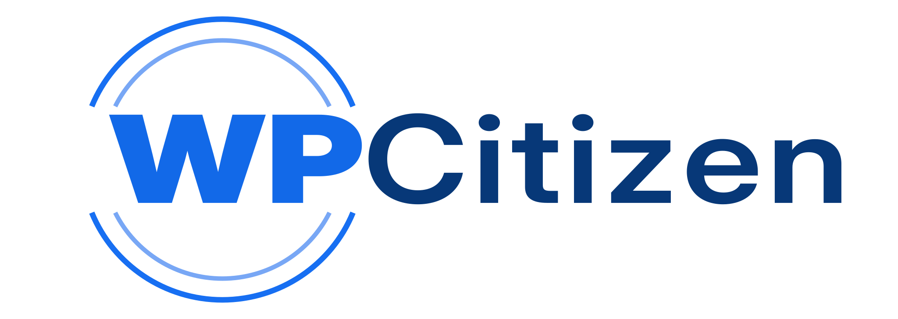

  

  <strong>Thoughtful tools for the WordPress ecosystem.</strong>

WP Citizen is a WordPress-focused software company building practical products for the people who create, manage, and grow websites and online businesses.

We turn everyday web and business challenges into straightforward software: useful features, clear interfaces, dependable engineering, and products designed to work well as projects grow.

## What we build

Our product focus is centered on the WordPress ecosystem and the workflows around it:

- **WordPress plugins and extensions** — focused tools that make websites more capable without adding unnecessary complexity.
- **WooCommerce and commerce workflows** — practical extensions for stores, orders, checkout, customer experiences, and operations.
- **Site-building and publishing tools** — better ways to create, manage, organize, and deliver web content.
- **Integrations and developer tools** — APIs, automation, licensing, updates, and connections between the tools people already use.
- **SaaS and connected services** — web-based products that complement WordPress and help teams work more efficiently.

## How we build

- **Solve real problems.** Start with the workflow and the people using it.
- **Keep software approachable.** Make powerful capabilities understandable and practical.
- **Respect the ecosystem.** Favor compatibility, extensibility, accessibility, and established WordPress conventions.
- **Build for the long term.** Treat security, documentation, testing, maintenance, and support as part of the product.
- **Stay community-minded.** Welcome thoughtful feedback and open-source collaboration where a project supports it.

## Work with us

Explore the repositories in this organization to see what we're building. Each project describes its own status, supported environments, installation steps, roadmap, and support options.

For contributions, start with the repository's `CONTRIBUTING.md` or the organization-wide [contribution guide](https://github.com/wpcitizen/.github/blob/main/CONTRIBUTING.md). For security reports, follow the project's private reporting instructions in [SECURITY.md](https://github.com/wpcitizen/.github/blob/main/SECURITY.md).

For support or custom work, visit [mizandev.com](https://www.mizandev.com) or email [dev@mizandev.com](mailto:dev@mizandev.com).
